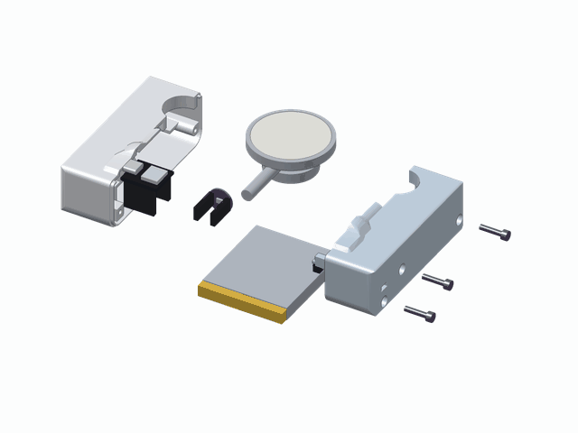
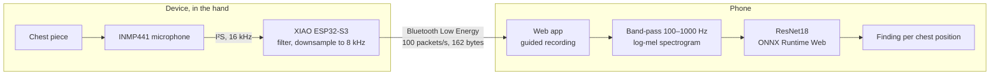

<div align="center">

<picture>
  <source media="(prefers-color-scheme: dark)" srcset="docs/brand/logo-lockup-dark.png">
  
</picture>

### The stethoscope anyone can use.

A low-cost digital stethoscope that shows you where to listen, paces your breathing,<br>
and screens your lung sounds with AI, on your phone.

[](LICENSE)


[**Try the app**](https://denis-furtuna.github.io/respirAI/) · [**Join the waitlist**](https://denis-furtuna.github.io/respirAI/waitlist.html) · [Architecture](docs/ARCHITECTURE.md) · [Project plan](docs/PLAN.md) · [Demo guide](docs/DEMO.md)

<br>

<picture>
  <source media="(prefers-color-scheme: dark)" srcset="docs/assembly-dark.gif">
  
</picture>

<sub>The whole device: two printed halves, a pharmacy stethoscope's chest piece, a microphone, one small board, a battery, three screws.</sub>

</div>

<br>

> [!IMPORTANT]
> respirAI is a student hackathon project, **not a medical device**. It does not diagnose and must not be used to make health decisions. If you are unwell, see a doctor. In an emergency, call 112.

## Contents

- [Why](#why)
- [What it does](#what-it-does)
- [How it works](#how-it-works)
- [Try it](#try-it)
- [Hardware](#hardware)
- [The model, with its real numbers](#the-model-with-its-real-numbers)
- [Project status](#project-status)
- [Repository](#repository)
- [Building it yourself](#building-it-yourself)
- [Roadmap](#roadmap)
- [Team](#team)
- [Acknowledgements](#acknowledgements)
- [License](#license)

## Why

The stethoscope has barely changed since Laennec invented it in 1816, and what it hears still takes a trained ear to interpret. Digital stethoscopes exist, but they start at around 250 USD and are built for clinicians.

respirAI answers one question for someone at home: **do these lungs sound normal, or should you see a doctor?**

It does not name a disease. It listens for two kinds of abnormal lung sound, *crackles* and *wheezes*, and tells you when a recording is worth showing to a doctor.

## What it does

| | |
|---|---|
| **Shows where to listen** | A body drawing and plain words mark each of the seven chest positions, front, sides and back. |
| **Paces the breathing** | A full-screen circle grows and shrinks: in for 2.5 s, out for 3.5 s. Each position is recorded for 12 seconds, two whole breaths. |
| **Talks you through it** | Spoken instructions in five languages, and an optional voice guide you can talk to while your hands hold the chest piece. |
| **Screens the sound on the phone** | A neural network checks each recording for crackles and wheezes. It runs in the browser, so the lung recordings never leave the phone. |
| **Checks the recording itself** | Silence, clipping, lost packets and handling noise lower a quality score; a poor recording is asked for again instead of being judged. |
| **Shares with a doctor** | A short summary and the recordings, through the phone's share sheet. |

No clinical training is needed to take a recording. The app is designed so an elderly person can follow it: one screen at a time, large text, plain words.

## How it works



1. **The device** captures sound at 16 kHz from a MEMS microphone sealed against the chest piece's stem, removes DC, low-passes it and sends 8 kHz, 16-bit audio in 10 ms packets over Bluetooth Low Energy.
2. **The app** reassembles the packets by sequence number, fills any gap with silence, and guides the person through the chest positions.
3. **The model** turns each recording into mel spectrograms and classifies 4-second windows as *normal*, *crackles*, *wheezes* or *both*. One finding is reported per position.

The parts meet at three fixed interfaces, so each could be built without waiting for the others:

| Interface | Contract |
|---|---|
| Firmware → App | BLE service `7b8c9d00-0001-…`; audio packets of 2-byte sequence number + 80 samples of 8 kHz 16-bit mono PCM; packet size adapts to the negotiated MTU |
| App → AI | one recording and a chest position code in; `finding`, `confidence`, `quality` out. The same contract is served on the phone and by an optional HTTP server (`POST /analyze`) |
| Electronics → CAD | measured part sizes in [`cad/components.csv`](cad/components.csv); the enclosure model reads its numbers from there |

Full specification: [`docs/ARCHITECTURE.md`](docs/ARCHITECTURE.md).

## Try it

**Without the device.** Open **<https://denis-furtuna.github.io/respirAI/>** and press *No device? Try a practice run*. The whole flow runs against a simulated device, through the real Bluetooth code.

**With the device.** Open the same page in Chrome on an Android phone (or on a computer with Bluetooth), switch the device on and press *Connect the device*. iPhone is not supported: Safari has no Web Bluetooth.

**As an Android app.** The same web app, packaged with Capacitor and built on GitHub Actions. See [`phone/README.md`](phone/README.md).

**On your own computer:**

```bash
git clone https://github.com/denis-furtuna/respirAI.git
cd respirAI
python app/dev/dev_server.py
# then open http://localhost:8000/?fakebt&wav=crackles.wav
```

No build step and nothing to install: the server is plain Python, and `?fakebt&wav=crackles.wav` streams a real lung recording through a fake Bluetooth device.

## Hardware

Everything is off the shelf, and the enclosure is two 3D-printed halves with no supports.

| Part | Role | Cost (lei) |
|---|---|---:|
| Seeed XIAO ESP32-S3 | microcontroller, Bluetooth, battery charging over USB-C | 48.45 |
| INMP441 | I²S MEMS microphone | 15.81 |
| LiPo 3.7 V, 2500 mAh | power | 39.27 |
| Slide switch | power on / off | 3.57 |
| Stethoscope (chest piece used) | acoustic front end | 30.00 |
| 3D print, PLA | enclosure, two halves | 28.00 |
| **Total** | | **165.10** |

About 32 EUR in parts.

- **Enclosure:** about 94 × 59 × 32 mm, closed around the chest piece's waist by three M3 screws. No tube and no earpieces: the microphone sits on the stem tip inside the body. The model is code ([`cad/case.py`](cad/case.py)) with automatic checks for collisions, assembly and printability.
- **Firmware:** `respirai-fw 0.5`. In testing: 0 packets lost out of 57,000 on USB and 25,000 on battery.
- **Battery:** not measured yet. The estimate is around 20 hours of continuous streaming; charging takes about a day at the board's 100 mA.

## The model, with its real numbers

Trained on the **ICBHI 2017 Respiratory Sound Database** (920 recordings, 126 participants, 6,898 labelled breathing cycles).

- **Sound labels, not disease labels.** About 86 % of ICBHI's patients have COPD, so a model trained on diagnoses scores well by always guessing one class.
- **Split by patient, never at random.** A random split puts the same patient in training and test, and inflates the score.
- **One preprocessing file** shared by training and serving, and a JavaScript port for the phone that is tested against the Python one.

What was measured on 15 November 2026 (ResNet18, per 4-second window, one run each):

| Tested on | ICBHI score | AUC, normal vs abnormal |
|---|---:|---:|
| New patients, stethoscopes seen in training | 49.7 % | 0.67 |
| AKG C417L left out of training | 48.7 % | 0.65 |
| Littmann 3200 left out | 35.8 % | 0.53 |
| Littmann Classic II SE left out | 62.4 % | 0.87 |
| Meditron left out | 39.6 % | 0.57 |

**What this means.** The model is a first screening pass and it is far from clinical accuracy. It does not carry well to a stethoscope it has not heard, and ours is one of those. The model in the app is provisional: at its current threshold it flags 83 % of the ICBHI validation recordings that contain crackles or wheezes, and leaves alone 42 % of the clear ones. On our own device, 1 of 5 unseen recordings of one healthy person was flagged.

Closing that gap needs recordings from our own device, which is what the [waitlist](https://denis-furtuna.github.io/respirAI/waitlist.html) is for. Details and raw numbers: [`ai/README.md`](ai/README.md), [`ai/results/`](ai/results/).

## Project status

| Part | State |
|---|---|
| Device | assembled and closed in its printed enclosure; streams over Bluetooth on battery |
| Firmware | working: capture, filtering, BLE stream, status |
| Web app | working: guided check, five languages, results, sharing; published on GitHub Pages |
| Android app | builds on GitHub Actions from the same web app |
| AI | provisional model running on the phone; honest scores above |
| Voice | recorded spoken instructions and an optional conversational voice guide (ElevenLabs) |
| Tests | browser test suites for the app run on every push; the DSP code has its own test |
| Carrier PCB | designed and checked ([`pcb/`](pcb/)), not ordered; the current device is wired by hand |
| Breathing lights | designed, then left out of this build; the phone's circle paces the breathing |
| ECG and pulse add-ons | planned ([`docs/ADDONS.md`](docs/ADDONS.md)), not built |

## Repository

```
firmware/   ESP32-S3: I²S capture, filtering, Bluetooth service
app/        web app: Web Bluetooth, guided recording, AI on the phone, results
phone/      the web app packaged as an Android app (Capacitor)
ai/         preprocessing, training, evaluation, optional inference server
cad/        the enclosure as code: model, checks, renders, STL files
pcb/        carrier board: generator, router, checks, fabrication files
docs/       plan, architecture, enclosure design, add-ons, demo guide
```

Each folder has its own README with the details.

## Building it yourself

| Step | Where |
|---|---|
| Wire the microphone, battery and switch to the XIAO | [`docs/PLAN.md` §3](docs/PLAN.md#3-wiring-reference) |
| Flash the firmware (Arduino IDE or `arduino-cli`) | [`firmware/README.md`](firmware/README.md) |
| Print the two halves and assemble | [`cad/README.md`](cad/README.md) |
| Train or replace the model | [`ai/README.md`](ai/README.md) |
| Build the Android app | [`phone/README.md`](phone/README.md) |

## Roadmap

- [ ] Record healthy and unwell volunteers with our own device, and retrain on those recordings
- [ ] Choose the reporting threshold on our own device's recordings
- [ ] Measure battery life; add deep sleep when no phone is connected
- [ ] Battery level in the app
- [ ] A custom board in place of hand wiring
- [ ] ECG and pulse modules on the same platform

## Team

Built in Timișoara for the **Medical Renaissance** track of [UniHack 2026](https://unihack.ligaac.ro/).

- Denis Furtună
- George Haragos

## Acknowledgements

- [ICBHI 2017 Respiratory Sound Database](https://bhichallenge.med.auth.gr/ICBHI_2017_Challenge), the data the model learned from
- [ONNX Runtime Web](https://onnxruntime.ai/), which runs the model in the browser
- [ElevenLabs](https://elevenlabs.io/), for the recorded voice and the voice guide
- [Capacitor](https://capacitorjs.com/), for the Android app
- [Seeed Studio](https://www.seeedstudio.com/) XIAO ESP32-S3 and [NimBLE-Arduino](https://github.com/h2zero/NimBLE-Arduino)

## License

[MIT](LICENSE)
