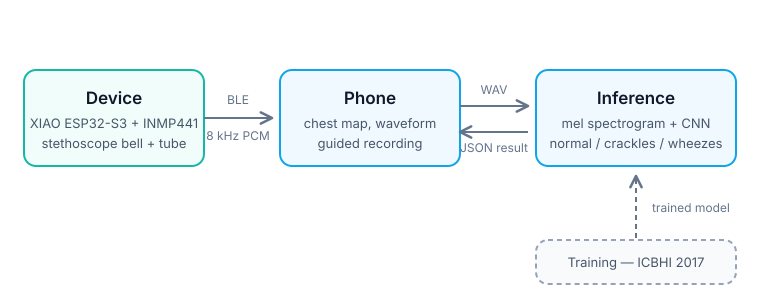

# respirAI — Architecture and Interface Contracts



respirAI is four parts that meet at three interfaces:

```
 ┌──────────┐   BLE (1)   ┌──────────┐  HTTP (2)  ┌──────────┐
 │ firmware │ ──────────▶ │   app    │ ─────────▶ │    ai    │
 │ ESP32-S3 │ ◀────────── │ Chrome   │ ◀───────── │ FastAPI  │
 └──────────┘   control   └──────────┘    JSON    └──────────┘
      ▲
      │ components.csv (3)
 ┌──────────┐
 │   cad    │
 └──────────┘
```

These contracts were fixed on day one so each part can be built without waiting for the others. **Changing one of them mid-project requires telling everyone it affects.** Source: [`PLAN.md` §4](PLAN.md#4-the-three-contracts).

---

## 1. Firmware ↔ App (BLE)

**Device name (advertised):** `respirAI`

### UUIDs

| Role | UUID | Properties |
|---|---|---|
| Service | `7b8c9d00-0001-4b5e-8f00-1a2b3c4d5e6f` | — |
| Audio stream | `7b8c9d00-0002-4b5e-8f00-1a2b3c4d5e6f` | Notify |
| Control | `7b8c9d00-0003-4b5e-8f00-1a2b3c4d5e6f` | Write |
| Status | `7b8c9d00-0004-4b5e-8f00-1a2b3c4d5e6f` | Notify |

### Audio format

PCM, signed 16-bit, little-endian, mono, **8000 Hz**.

The device captures at 16 kHz and low-pass filters + downsamples to 8 kHz before sending.

### Audio packet — 162 bytes

| Bytes | Content |
|---|---|
| 0–1 | sequence number, uint16 little-endian, wraps at 65535 |
| 2–161 | 80 audio samples (10 ms) |

Rate: 100 packets/s ≈ 16 KB/s. The app uses the sequence number to detect dropped packets and fills gaps with silence.

### Control commands (write to Control)

Single byte, or byte + argument.

| Command | Meaning |
|---|---|
| `0x01` | start audio streaming |
| `0x02` | stop audio streaming |
| `0x10` | LED: start the breathing guide and loop it until `0x11` or `0x12`. A trailing chest-point byte (`0x10 <n>`) is accepted and ignored: the phone shows the place |
| `0x11` | LED: place recorded — the lungs fade out |
| `0x12` | LED: stop the guide, the lungs fade out over 300 ms |
| `0x20` | send status now |

### Breathing sync

The device's lungs and the app's circle must look like one breath. This is part of the contract:

- **The app owns the timer.** It sends `0x10`, starts its circle when the write is confirmed, and decides when to stop. The device only loops the breath. No animation frames go over Bluetooth, and every recording sends a fresh `0x10`, so each take starts in step.
- **Tempo: in 4 s, out 5 s, no hold.** Written twice and kept equal: `BREATH_IN_MS` / `BREATH_OUT_MS` in `firmware/respirai/config.h` and `BREATH_IN` / `BREATH_OUT` in `app/app.js`. Changing it means changing both, and reflashing.
- **Curve:** f(t) = (1 − cos πt) / 2, rising over breathe-in, falling over breathe-out. App: circle size linear in f, drawn every frame, no CSS easing. Device: LED duty = max · f^2.2 (gamma on the LEDs only). The trachea leads the lobes slightly (`TRACHEA_LEAD`); their average stays within a few % of the circle.
- **Recordings are whole breaths** (default 18 s = 2), after one practice breath, so a recording ends at the bottom of a breath. The device also fades out over 300 ms whenever it stops.
- **Safety stop:** a guide that runs 60 s stops by itself.
- Clock drift between phone and device is ~1 ms over a recording: no resync needed.

### Status packet — 4 bytes

Sent every 2 s, and immediately on `0x20`.

| Byte | Content |
|---|---|
| 0 | battery percent, 0–100; 255 = unknown (no battery sense wired) |
| 1 | state: `0` idle, `1` streaming, `2` error |
| 2–3 | packets sent since last status, uint16 LE |

### Chest point numbering

Matches the codes in contract 2 (and the optional byte after `0x10`). This is ICBHI's own listing order, so no lookup table is needed anywhere.

| n | Code | Position |
|---|---|---|
| 0 | `Tc` | Trachea |
| 1 | `Al` | Anterior left |
| 2 | `Ar` | Anterior right |
| 3 | `Pl` | Posterior left |
| 4 | `Pr` | Posterior right |
| 5 | `Ll` | Lateral left |
| 6 | `Lr` | Lateral right |

The app may visit the points in any order; only the numbering is fixed.

### MTU — adaptive, not assumed

BLE defaults to an MTU of 23 bytes, far below the 165 a full packet needs, and the peripheral cannot force a larger one. The firmware reads the negotiated MTU at subscribe time and sizes the payload from it:

```
samples = min(80, floor((mtu - 5) / 2) rounded down to even)
```

80 samples (10 ms) whenever MTU ≥ 165, fewer if the central negotiates low.

- The packet size is **fixed for the life of a connection**. The app learns it from the first packet's length, and uses it to know how many samples of silence a missing sequence number stands for.
- A low MTU keeps the packet format valid but not necessarily the data rate: at MTU 23 the same 16 KB/s needs ~1000 packets/s, which BLE may not sustain. F4 logs the negotiated MTU on the actual demo phone to confirm the full 165.

### Add-on characteristics

Each add-on gets its own characteristic so the audio stream is untouched. See [`ADDONS.md`](ADDONS.md).

| Role | UUID | Format |
|---|---|---|
| ECG | `7b8c9d00-0005-4b5e-8f00-1a2b3c4d5e6f` | Notify. 250 Hz, int16 samples. Packet: 2-byte sequence + 16 samples = 34 bytes, ~15.6 packets/s. Lead-off flag travels in the status packet. |
| Pulse | `7b8c9d00-0006-4b5e-8f00-1a2b3c4d5e6f` | Notify at 1 Hz, 4 bytes: heart rate uint8 bpm, SpO2 uint8 %, quality uint8 0–100, flags uint8. No waveform; the ESP32 computes the values from the MAX30102's raw red/IR samples. |

---

## 2. App ↔ AI (HTTP)

### `POST /analyze`

`multipart/form-data`

| Field | Type | Notes |
|---|---|---|
| `audio` | file | WAV, 8000 Hz, 16-bit PCM, mono, 10–20 s. **Omitted in demo mode.** |
| `point` | string | one of `Tc, Al, Ar, Pl, Pr, Ll, Lr` (ICBHI chest position codes) |
| `session_id` | string | groups the points of one patient session |
| `demo` | bool, optional | if true, the server analyses a dataset clip instead |
| `demo_case` | string, demo only | one of `normal`, `crackles`, `wheezes`, `both` |

**Demo mode.** When `demo=true`, no `audio` file is sent; `demo_case` says which kind of clip to use. The server holds one hand-picked ICBHI clip per case per chest point (28 in all), committed under `ai/demo_clips/`, and runs it through the identical preprocessing and model. It's deterministic, so it can be rehearsed and behaves the same on stage. The response has the normal shape plus `"demo": true`.

Pick the clips **after** the model is trained, from the **test split**: a clip from the training set would show an unrealistically confident result, and a clip the model gets wrong would show the wrong finding on stage.

**Response, HTTP 200:**

```json
{
  "point": "Al",
  "finding": "crackles",
  "confidence": 0.81,
  "quality": 0.93,
  "model_version": "resp-cnn-0.3",
  "latency_ms": 420
}
```

- `finding` is one of: `normal`, `crackles`, `wheezes`, `both`, `unusable`
- `quality` (0–1) reflects signal quality; **below 0.4 the app should ask the user to re-record**
- Errors return HTTP 4xx with `{"error": "human readable message"}`

### `GET /session/{session_id}/summary`

```json
{
  "session_id": "abc123",
  "points_recorded": 6,
  "overall": "crackles",
  "confidence": 0.76,
  "per_point": [{"point": "Al", "finding": "crackles", "confidence": 0.81}],
  "disclaimer": "Screening aid only. Not a diagnosis. Consult a doctor."
}
```

### Wording rule

The API and the UI never say "diagnosis". Use "finding", "screening", "possible abnormal sounds — see a doctor".

### Where the server runs

- **Phase 1:** FastAPI on the laptop; the phone uploads over the laptop's hotspot.
- **Phase 2 (only if time allows):** the model exported to ONNX and run in Chrome with ONNX Runtime Web. The FastAPI path stays as the fallback, and this contract stays the shape of the result either way.

---

## 3. Electronics ↔ CAD (`components.csv`)

**Single source of truth:** [`cad/components.csv`](../cad/components.csv), one row per part, filled in by Electronics using calipers and read by CAD. **CAD never measures from a photo or a datasheet.**

| Column | Meaning |
|---|---|
| `part` | component name |
| `w_mm`, `l_mm`, `h_mm` | measured bounding box |
| `hole_pattern` | mounting hole spacing, if any |
| `connector_face` | which face its connector must reach |
| `clearance_mm` | extra space needed for wires |

### Starting values — all to be confirmed with calipers

These are nominal and are **not** in the CSV on purpose. The CSV only gets measured values.

| Part | Nominal size | Connector face |
|---|---|---|
| XIAO ESP32-S3 | 21 × 17.8 × 3.5 mm | USB-C on one short edge |
| INMP441 module | ~15 × 13 mm | tube barb on base |
| LED, 3 mm diffused (×4) | Ø3 mm, ~5 mm tall + legs | on standoffs above the battery, pointing up into the light chambers |
| LiPo 2500 mAh | 60 × 50 × 8 mm | internal |
| Slide switch | 8.6 × 4.3 × 4 mm | side slot |
| AD8232 (optional) | measure | 3.5 mm jack on side |

### Rules

- Holes for connectors: nominal + 0.4 mm.
- Internal clearance around boards: 1 mm minimum.
- Wall thickness 2 mm; top panel 1.2–1.5 mm white PLA with 0.4 mm thin regions for the lungs and the wordmark (see ENCLOSURE.md).
- The case is expected to need **two print rounds**. Order v1 at least 10 days before the demo.

---

## Open questions — not yet part of any contract

Found while extracting the contracts above. Each needs a decision from the people on both sides of the interface; until then, don't build on an assumption.

1. **Lead-off flag in the status packet.** The ECG characteristic says the lead-off flag travels in the status packet, but the status packet is still the 4-byte layout above with no slot for it. Either use spare bits of byte 1 (state only needs values 0–2) or extend the packet to 5 bytes.
2. **ECG packet vs. low MTU.** The 34-byte ECG packet needs MTU ≥ 37, so unlike audio it doesn't adapt to the 23-byte default. In practice this is fine because audio already needs 165, but if the adaptive fallback ever kicks in, ECG needs the same treatment.
3. **`components.csv` location.** The plan calls it "one shared spreadsheet"; the enclosure blueprint puts it at `cad/components.csv`. This repo uses `cad/components.csv`.

Resolved: chest point numbering, MTU handling, demo mode request shape, add-on data formats.
