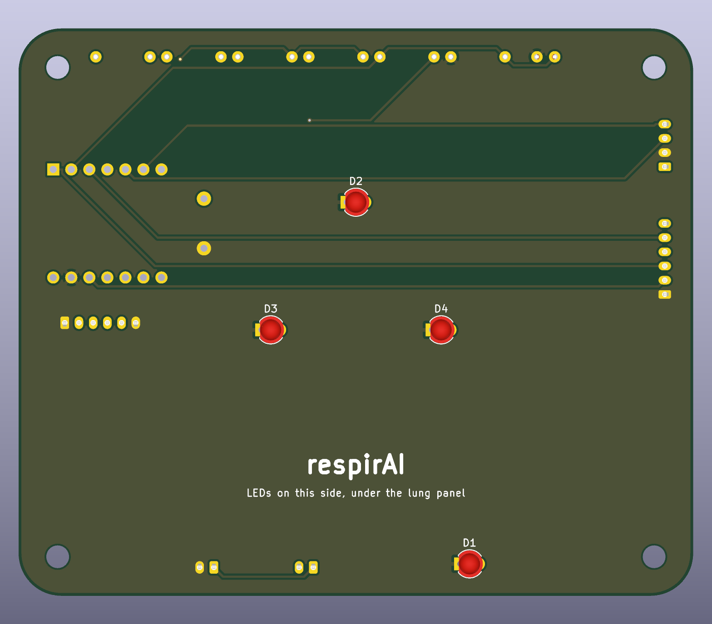
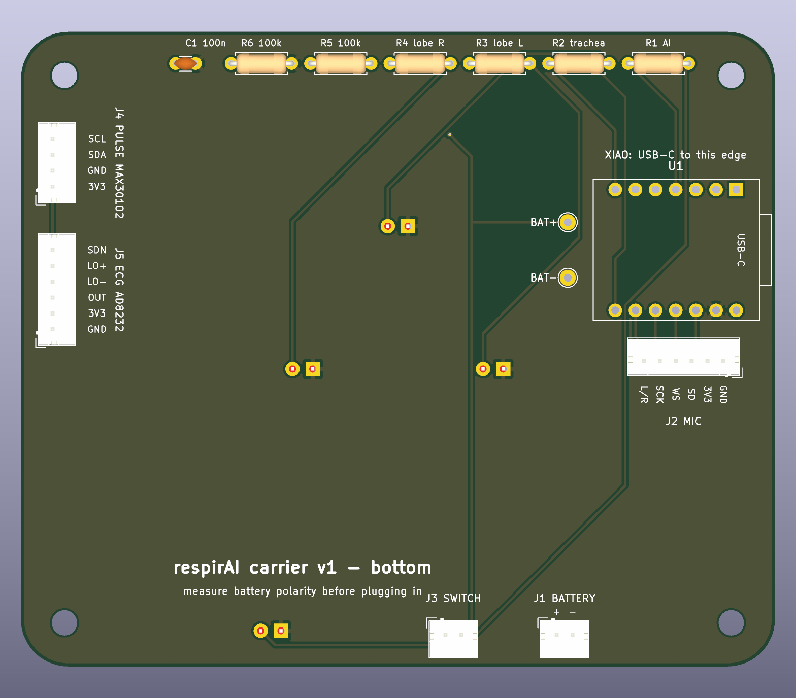

# pcb/: the carrier board

One board that replaces the jumpers. It sits right under the lid, screwed onto the case's four corner posts: the four LEDs are on top, shining straight into the lung panel, and everything else hangs underneath. The modules you already have plug into it: the XIAO, the mic, and later the ECG and pulse sensors. No chips to solder, only through-hole parts.

 

| On the board | Side | Pins (firmware/respirai/config.h, docs/ADDONS.md) |
|---|---|---|
| XIAO ESP32-S3, USB-C to the left wall | bottom | — |
| 4 LEDs: trachea, two lobes, the "AI" of the wordmark | top | D6, D7 (both lobes, one resistor each), D3 |
| J2 mic plug, 6 pins: GND, 3V3, SD, WS, SCK, L/R (to GND) | bottom | D10, D9, D8 |
| J1 battery plug, J3 switch plug | bottom | through the switch to the XIAO's BAT+ |
| Battery level: 2 × 100 kΩ + 100 nF | bottom | D1 |
| J4 pulse (MAX30102): 3V3, GND, SDA, SCL | bottom | D4, D5 (add-on, can stay empty) |
| J5 ECG (AD8232): GND, 3V3, OUT, LO−, LO+, SDN | bottom | D0, D2 (add-on, can stay empty) |

All 11 of the XIAO's pins are used, as planned in `docs/ADDONS.md`. Its 5V pin stays unconnected: the board runs from the LiPo.

## Before ordering: three checks

1. **Print `fab/respirai-carrier-1to1-top.pdf` at 100 % (no "fit to page") and lay the parts on it.** The XIAO's pins must sit on its 14 holes, the LEDs on theirs, the plugs on theirs. Thirty seconds, and the most common PCB mistake is caught.
2. **The case designer agrees on the outline:** 95 × 80 mm, corner radius 6, centred in the 100 × 85 mm case; M3 holes on the case's four corner posts, 8 mm in from each wall's outer face (as in `docs/ENCLOSURE.md`). The board sits under the lid; below it hang the XIAO (≈ 13 mm in female headers, ≈ 7 mm soldered straight in) and the plugs (≈ 7 mm). Keep those clear of the battery and the mic pocket.
3. **The lung panel artwork matches the LEDs.** Centres, from the front-left corner seen from above: trachea X 50 / Y 58, lobes X 38 / Y 40 and X 62 / Y 40, "AI" X 66 / Y 7 (all mm). To move one, change its line in `generate.py` and rebuild.

## Order it (JLCPCB)

1. jlcpcb.com → *Order now* → *Add gerber file* → `fab/respirai-carrier-jlcpcb.zip`. It reads 2 layers and 95 × 80 mm by itself.
2. Leave the defaults: FR-4, 1.6 mm, 1 oz copper, HASL (lead-free if you like). Any colour; quantity 5 is the minimum and costs about the same as 1.
3. Shipping: DHL or FedEx express, about 4–6 days to Romania. Order by ~21 October and there are two weeks left for assembly and tests before 13 November.

No assembly service needed: everything is through-hole and hand-soldered.

## Parts

| Ref | Part | Qty |
|---|---|---|
| U1 | Seeed XIAO ESP32-S3 (you have it) + 2 × 1×7 female headers, 2.54 mm, to keep it removable | 1 |
| D1–D4 | 3 mm diffused LED (you have them). Long leg = anode = the round pad; short leg = the square pad | 4 |
| R1–R4 | 100 Ω, ¼ W axial (47 Ω for brighter, never lower) | 4 |
| R5, R6 | 100 kΩ, ¼ W axial | 2 |
| C1 | 100 nF ceramic, 2.5 mm pitch | 1 |
| J1, J3 | JST PH 2.0 mm, 2-pin, vertical (B2B-PH-K) | 2 |
| J4 | JST PH 2.0 mm, 4-pin, vertical (B4B-PH-K) | 1 |
| J2, J5 | JST PH 2.0 mm, 6-pin, vertical (B6B-PH-K) | 2 |
| cables | JST PH 2.0 pre-crimped leads with open ends: 2-pin × 1 (switch), 6-pin × 1 (mic), later 4-pin and 6-pin for the add-ons. A small JST PH kit covers it | — |

The LiPo (LP-785060) already ends in a JST PH 2.0 plug, so it goes straight into J1. **Measure its polarity first:** cheap LiPos wire the plug either way round. If its + doesn't land on the pin marked + on the board, swap the two crimps in the plug (lift the tab with a needle) — never plug in reversed, the XIAO has no protection.

## Assembly order

Lowest parts first, testing as you go with the module tests on the `firmware` branch:

1. **Resistors and C1** (bottom side, the row along the rear edge). The labels say which LED each one feeds.
2. **LEDs** from the top: long leg in the round pad. Leave them a little proud so they reach the panel.
3. **Plugs J1–J5** from the bottom.
4. **Two short wires** from the BAT+ / BAT− pads to the XIAO's BAT+ / BAT− pads (on its underside, BAT− nearer the USB-C). Solder these to the XIAO first, then mount it.
5. **The XIAO** in its female headers, USB-C towards the board edge marked on the silkscreen.
6. Test: `firmware/led_test` (each LED lights, `i`), `firmware/mic_test` (wiring check says OK), then the full firmware with the app. With the divider on the board, set `PIN_BATTERY = 2` in `config.h` so the app shows the battery level.

## Files

| File | What it is |
|---|---|
| `generate.py` | places every part, names every net, draws the outline and ground fills. **Change the board here**, not in KiCad |
| `route.py` | routes it with Freerouting and fills the ground planes |
| `check.py` | checks the result against the firmware's own pins (`config.h`), independently of how `generate.py` named things |
| `build.py` | all of the above + KiCad's DRC + the exports below; stops at the first failure |
| `respirai-carrier.kicad_pcb` | the routed board; opens in KiCad 10 |
| `respirai.pretty/` | the XIAO footprint, from Seeed's own (pins 15.24 mm apart, 2.54 mm pitch) |
| `fab/` | what to send and print: the Gerber zip for JLCPCB, 1:1 PDFs, renders |

Rebuild after any change (KiCad 10, Freerouting 2.x and the Java it needs):

```bash
JAVA=path/to/java FREEROUTING_JAR=path/to/freerouting-2.4.1.jar python pcb/build.py
```

The last build: every connection routed (2 vias), KiCad DRC with all severities: 0 violations, 0 unconnected; `check.py`: all 46 checks pass.
